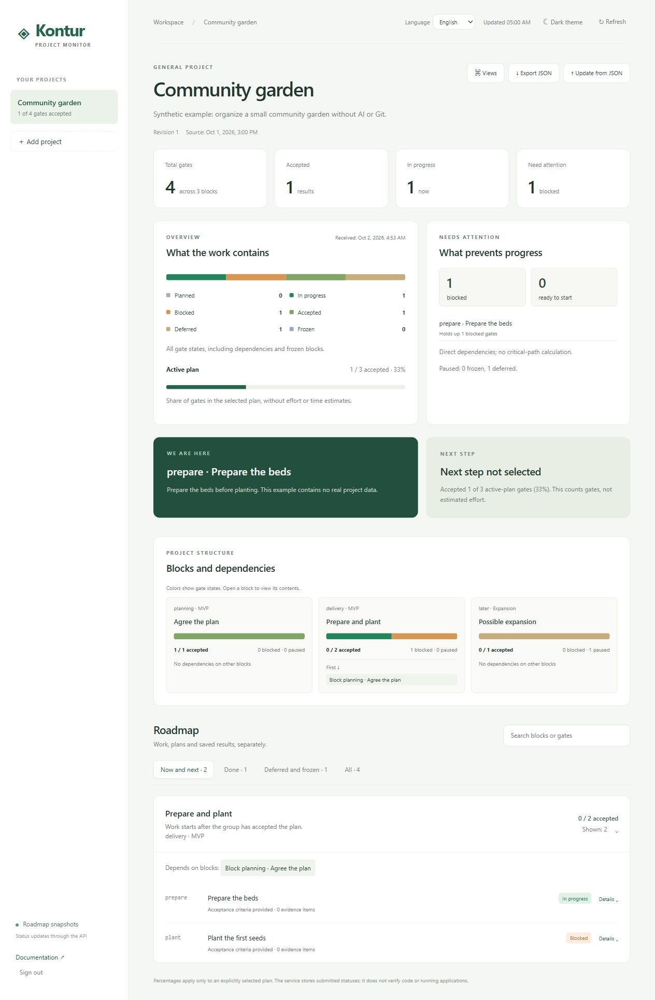

# Контур

**Локальный монитор проектов: дорожные карты, зависимости, доказательства, календарная шкала и необязательные снимки Git.**

[English](../README.md) · [简体中文](README.zh-CN.md) · [API](API.md) · [Интеграция](INTEGRATIONS.md)

Контур показывает переданное состояние проекта: что сейчас в работе, что принято и что ожидает завершения зависимостей. Используйте его с агентом, способным вызывать HTTP API, обычным скриптом или вручную через JSON. Модель, подписка на API и Git не нужны.



## Возможности

- Английский, русский и упрощённый китайский интерфейс; выбор языка сохраняется.
- Блоки и гейты с критериями приёмки, источниками и доказательствами.
- Проверка зависимостей, один текущий гейт и отдельно выбранный активный план.
- Обзор, схема дорожной карты, календарная шкала и необязательное Git-дерево.
- Импорт/экспорт JSON, последние 100 ревизий проекта и API с `If-Match`.
- FastAPI, SQLite и обычный HTML/CSS/JS. Без сборки фронтенда, внешних CDN и телеметрии.

Статус `done` означает переданную приёмку. Сервис не доказывает качество работы агента. Процент плана считает гейты с одинаковым весом, а не готовность продукта или трудозатраты. Даты показывают календарные интервалы. Git не доказывает исходную ветку создания другой ветки.

## Запуск

Python 3.10+, Windows PowerShell 7:

```powershell
git clone https://github.com/zoomerland/kontur.git
Set-Location kontur
python -m venv .venv
.\.venv\Scripts\python.exe -m pip install -r requirements.txt
.\.venv\Scripts\python.exe run.py
```

Для Linux/macOS используйте `python3 -m venv .venv`, затем `.venv/bin/python` вместо Windows-пути. Откройте **http://127.0.0.1:8766**. Случайный ключ создаётся в `data/api-token.txt`; прочитайте его локально и введите в браузере:

```powershell
Get-Content -LiteralPath ./data/api-token.txt
```

Один ключ даёт доступ ко всем проектам установки. Храните `data/` приватно. Это сервис для одного владельца и доверенных клиентов, без отдельных прав пользователей.

## Попробовать без модели

1. Создайте проект «Community garden» с ID `community-garden`, тип «Обычный проект».
2. Выберите проект и импортируйте `examples/general-project.json` через кнопку «Импорт JSON».
3. Подтвердите замену и откройте карточку текущего гейта, обзор и календарную шкалу.
4. Экспортируйте JSON, меняйте его обычным редактором и импортируйте снова. Предыдущая ревизия сохраняется в истории.

Пример разработки: ID `demo-software`, тип `software`, файл `examples/software-project.json`. Все примеры и снимки экрана вымышленные. Встроенного полного редактора дорожной карты пока нет; интерфейс создаёт проекты и импортирует снимки. Тип `general` подходит для исследований, событий и других проектов с явными этапами.

## Модели и инструменты

Контракт — HTTP и JSON. Агент с HTTP-инструментами может передавать состояние после разрешённого checkpoint. Модель в обычном чате может подготовить JSON, который человек проверит и импортирует. Встроенных подключений к конкретным провайдерам нет; совместимость со всеми моделями не заявляется. См. [инструкции интеграции](INTEGRATIONS.md) и [шаблон проектных правил](AGENTS.example.md).

## Git по желанию

Сначала получите локальный файл для проверки, без передачи ключа или сетевого запроса:

```powershell
pwsh -File ./scripts/Publish-GitSnapshot.ps1 `
  -ProjectId demo-software -RepositoryPath ./ -OutputPath ./data/git-preview.json
```

Без `-OutputPath` сборщик отправляет снимок локальному монитору. Другую установку задают через `-MonitorUrl` и `-TokenPath`; для удалённого адреса обязателен HTTPS. В снимке есть названия веток и темы коммитов — проверьте их на приватность. Сборщик выполняет только читающие команды Git; содержимое изменённых файлов не читает.

## Настройка и безопасность

Параметры: `run.py --help`. Переменные: `KONTUR_DATA`, `KONTUR_TOKEN`, `KONTUR_HOST`, `KONTUR_PORT`, `KONTUR_ALLOWED_HOSTS`, `KONTUR_SSL_CERTFILE`, `KONTUR_SSL_KEYFILE`. По умолчанию сервер слушает только loopback. Для прямого сетевого доступа нужны явный список разрешённых хостов и TLS. Лучше использовать доверенный HTTPS proxy или приватный туннель с loopback backend. Приложение не меняет firewall, учётные записи и задания Windows. [Безопасность и резервные копии](../SECURITY.md).

## Участие

Ошибки и предложения: [GitHub Issues](https://github.com/zoomerland/kontur/issues). Не прикладывайте реальные ключи и планы. Приветствуются исправления переводов и небольшие PR; [правила участия](../CONTRIBUTING.md). Ранняя версия, лицензия [MIT](../LICENSE). Код и документация создавались с помощью AI; решения о приёмке остаются за людьми.
