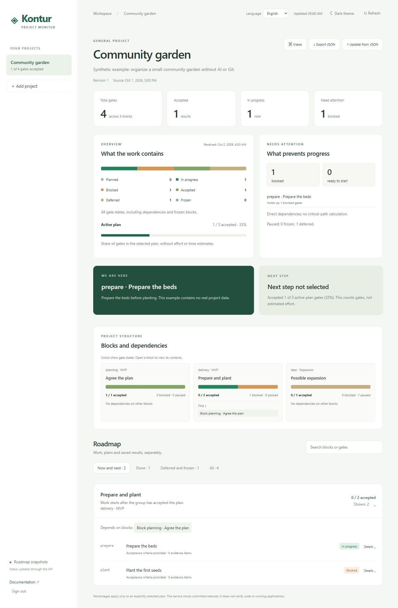

# Kontur

**可自行部署的项目看板：路线图、依赖关系、验收依据、时间线，以及可选的 Git 快照。**

[English](../README.md) · [Русский](README.ru.md) · [API 指南](API.md) · [集成指南](INTEGRATIONS.md)

Kontur 展示明确提交的项目状态：当前在做什么、哪些里程碑已验收、哪些步骤还在等待依赖。你可以通过支持 HTTP 请求的 AI 代理、普通脚本，或手动维护的 JSON 文件使用它。不需要任何模型、模型 API 订阅或 Git 仓库。



## 功能

- 英语、俄语和简体中文界面，保存语言偏好。
- 路线图分组和里程碑，支持验收标准、来源及证据引用。
- 依赖关系校验、一个当前里程碑，以及单独选择的活动计划。
- 概览、路线图、日历时间线和可选的 Git 图。
- JSON 导入与导出，保留项目最近 100 个版本。
- 带 `If-Match` 并发控制的 HTTP API。
- FastAPI、SQLite 和原生 HTML/CSS/JavaScript，无前端构建、外部 CDN 或遥测。

`done` 表示提交者报告已经验收，Kontur 不会独立证明工作质量。计划百分比按同等权重的里程碑计算，不代表产品整体完成度或工作量。时间线展示日历区间。Git 图使用提交的真实引用和父提交关系，不能证明分支最初从哪里创建。

## 本地运行

需要 Python 3.10+。Windows PowerShell 7：

```powershell
git clone https://github.com/zoomerland/kontur.git
Set-Location kontur
python -m venv .venv
.\.venv\Scripts\python.exe -m pip install -r requirements.txt
.\.venv\Scripts\python.exe run.py
```

Linux/macOS 使用 `python3 -m venv .venv`，并将 Python 路径改为 `.venv/bin/python`。打开 **http://127.0.0.1:8766**。随机访问密钥会保存在 `data/api-token.txt`。在本机读取后输入浏览器：

```powershell
Get-Content -LiteralPath ./data/api-token.txt
```

一个密钥可以读写该实例的所有项目。请勿公开 `data/`。本版本面向单一所有者与可信客户端，没有独立的用户权限。

## 不使用模型也能试用

1. 创建项目，名称 `Community garden`，ID `community-garden`，类型选择“通用项目”。
2. 选择该项目，点击导入 JSON，使用 `examples/general-project.json`。
3. 确认替换，查看当前里程碑、概览和时间线。
4. 导出 JSON，用普通编辑器修改，再导入。先前版本会保留在历史记录中。

软件项目示例：ID `demo-software`，类型 `software`，导入 `examples/software-project.json`。所有示例及截图均为虚构数据。界面目前支持创建项目和导入快照，不是完整的行内路线图编辑器。`general` 类型可用于研究、活动及其他有明确里程碑的项目。

## 模型和工具

集成接口是 HTTP 和 JSON，而不是某个模型 SDK。支持 HTTP 工具的代理可以在获准的检查点提交状态。仅能聊天的模型可以生成 JSON 草稿，由人审核后导入。此版本没有内置的模型供应商连接器，也不声称已测试所有模型。请参阅[集成指南](INTEGRATIONS.md)及[项目指令模板](AGENTS.example.md)。不要将访问密钥写入提示词、JSON 或 Git。

## 可选的 Git 快照

需要 PowerShell 7 和 Git。先生成本地预览，不读取访问密钥，也不发送网络请求：

```powershell
pwsh -File ./scripts/Publish-GitSnapshot.ps1 `
  -ProjectId demo-software -RepositoryPath ./ -OutputPath ./data/git-preview.json
```

不指定 `-OutputPath` 时会将快照发送至本机 Kontur。其他实例使用 `-MonitorUrl` 和 `-TokenPath`；非 loopback 地址必须使用 HTTPS。快照包含分支名称和提交标题，分享前请检查敏感信息。收集器只执行 Git 读取命令，不读取已修改文件内容。

## 配置和安全

运行 `run.py --help` 查看选项。环境变量包括 `KONTUR_DATA`、`KONTUR_TOKEN`、`KONTUR_HOST`、`KONTUR_PORT`、`KONTUR_ALLOWED_HOSTS`、`KONTUR_SSL_CERTFILE`、`KONTUR_SSL_KEYFILE`。默认只监听 loopback。直接监听网络地址必须配置明确的主机白名单和 TLS。建议使用可信 HTTPS 反向代理或私人隧道，并让后端保持 loopback。应用不会修改防火墙、系统账户或 Windows 计划任务。参阅[安全与备份指南](../SECURITY.md)。

## 参与

欢迎通过 [GitHub Issues](https://github.com/zoomerland/kontur/issues) 提交问题及翻译建议，使用虚构或脱敏示例。参阅[贡献指南](../CONTRIBUTING.md)。本项目是早期版本，使用 [MIT 许可证](../LICENSE)。代码和文档在 AI 协助下开发；验收和发布决定由人负责。
